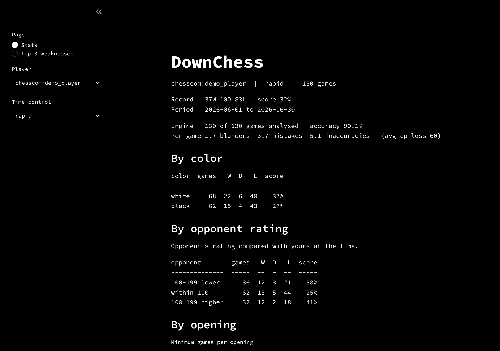
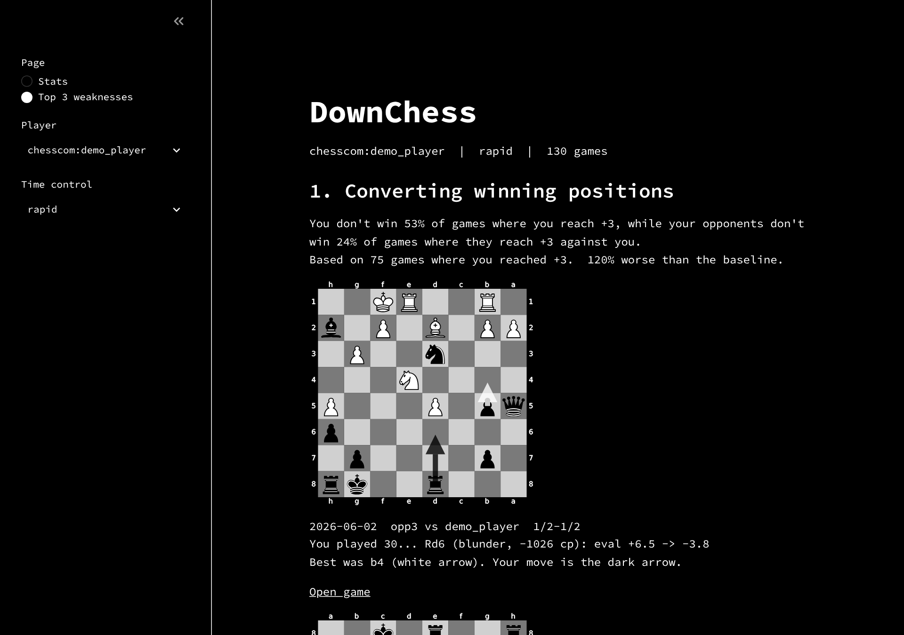

# DownChess

[](https://github.com/Scr1ble12/DownChess/actions/workflows/tests.yml)

**Find out what's actually costing you games.** DownChess pulls every game for a Chess.com or Lichess username, runs Stockfish over them, and reports your three biggest weaknesses with the numbers behind them and example positions from your own games.

It runs locally: Python, SQLite, Stockfish and a plain white-on-black Streamlit dashboard. Rapid games are the default focus.

| Stats | Top 3 weaknesses |
| --- | --- |
|  |  |

<sub>Screenshots use generated demo games.</sub>

## What it does

- **Fetches** your full public game history from Chess.com and Lichess into one SQLite file. Reruns only download new games.
- **Analyses** every move with Stockfish: centipawn loss, a label (ok, inaccuracy, mistake, blunder), the game phase, and a Lichess-style accuracy score. Games Lichess already analysed reuse that analysis.
- **Summarises** your record by color, opponent rating, opening and month.
- **Ranks your weaknesses.** Six checks each compare you with a baseline from your own games. The three biggest gaps are shown with example boards: the position before your worst move, your move (dark arrow) and the engine's best move (white arrow).

| Check | You | Compared with |
| --- | --- | --- |
| Game phase | Avg centipawn loss in your worst phase | The other phases |
| Openings | Score in your worst opening and color (10+ games) | Your overall score |
| Time trouble | Blunder rate with under 2 min or 10% of your time left | Blunder rate with more time |
| Converting wins | Share of games you don't win after reaching +3 | How often opponents fail to win from +3 against you |
| After a loss | Score in the next game within 2 hours of a loss | Score after a win |
| Rating gap | Score against opponents 50+ points higher or lower | The Elo-expected score |

A check has to be at least 10% worse than its baseline to count, and every number shows the sample it's based on.

## Quick start

Needs Python 3.11+ and Stockfish (`brew install stockfish` on macOS, `apt install stockfish` on Debian/Ubuntu).

```bash
git clone https://github.com/Scr1ble12/DownChess.git
cd DownChess
python3 -m venv .venv
source .venv/bin/activate            # Windows: .venv\Scripts\activate
pip install -r requirements.txt

python cli.py fetch chesscom:<username>     # or lichess:<username>
python cli.py analyze chesscom:<username>   # Stockfish over your latest 200 rapid games
streamlit run app.py                        # opens the dashboard in your browser
```

Streamlit keeps its terminal busy, so run other commands in a second terminal tab.

## Commands

| Command | What it does |
| --- | --- |
| `python cli.py fetch <site>:<user>` | Download games (rapid only). `--all-speeds` for every time control, `--full` to re-download everything. |
| `python cli.py analyze <site>:<user>` | Run Stockfish. `--games 500` to go further back, `--depth 14` to go deeper, `--workers N` to set processes. Safe to stop with Ctrl+C; the next run continues. |
| `python cli.py summary <site>:<user>` | Show what's stored, by time control. |
| `python cli.py moves <file.pgn>` | Print a PGN's moves and clocks. |

Optional environment variables:

| Variable | What it does |
| --- | --- |
| `STOCKFISH_PATH` | Path to the Stockfish binary, if it isn't on your `PATH`. |
| `LICHESS_TOKEN` | A Lichess API token. Not needed, but speeds up downloads from about 20 to 30 games per second. |
| `DOWNCHESS_CONTACT` | Contact info for the User-Agent both sites ask for. Defaults to this repo's URL. |
| `DOWNCHESS_DB` | A different SQLite file for the dashboard. Default `data/downchess.db`. |

## How it works

```
fetch (Chess.com / Lichess)  ->  normalize  ->  SQLite  ->  Stockfish pass  ->  stats  ->  Streamlit
```

Each stage reads from and writes to SQLite, so any stage can be rerun on its own.

- **Fetching.** Chess.com serves monthly archives; months already stored are skipped except the newest. Lichess streams NDJSON; only games after the newest stored one are requested. Requests are sequential with a descriptive User-Agent and a one-minute wait on HTTP 429, as both sites ask.
- **One game format.** Both sites provide a PGN, so moves, clocks (`%clk`) and Lichess evals (`%eval`) all go through one python-chess path in `fetch/normalize.py`. Nothing downstream knows which site a game came from.
- **Engine pass.** One single-threaded Stockfish per CPU core, each on a different game, which is faster at shallow depth than one multi-threaded engine. Workers only compute; the main process does all writes. The first 8 plies count as opening theory. Results are committed per game, and asking for a greater depth re-queues games.
- **Move labels.** Centipawn loss is the mover's drop in eval across the move, with evals capped at ±1000: inaccuracy ≥ 50, mistake ≥ 100, blunder ≥ 300. Endgame means at most 13 points of non-pawn material per side. Accuracy uses Lichess's win-percentage formula.

## Project layout

```
fetch/      chesscom.py, lichess.py, normalize.py, sync.py, http.py
db/         schema.sql, store.py
engine/     runner.py (batch Stockfish), classify.py (labels, phase, accuracy)
stats/      games.py, results.py, analysis.py, weaknesses.py
ui/         views.py (pages), board.py (board images), text.py (plain-text tables)
app.py      Streamlit dashboard
cli.py      fetch / analyze / summary / moves
tests/      pytest suite with saved site responses (no network needed)
```

## Tests

```bash
pytest
```

The suite uses saved Chess.com and Lichess responses, so it never touches the network. Engine tests run against a real Stockfish when one is installed and are skipped otherwise. GitHub Actions runs everything on each push.

## Ideas for later

- Practice drills built from your own mistakes
- Tactical motif tagging (forks, pins, hanging pieces)
- Comparing against players at your rating instead of only against yourself
